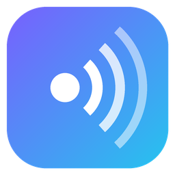

# Echo



**Echo** enregistre vos appels **Microsoft Teams** et **Discord** sous Windows, dans une application moderne où tout se gère :

1. choisissez **Teams** ou **Discord** ;
2. cliquez sur **Démarrer l'enregistrement** ;
3. Echo enregistre **uniquement** le son de l'application choisie et **votre micro, seulement quand il est actif dans cette application** : si vous êtes en muet (ou en sourdine dans Discord), votre voix n'est pas enregistrée ;
4. pendant l'appel, Echo montre **qui parle en temps réel** : vous, et chaque autre participant — avec son **pseudo Discord exact** si vous connectez Echo à Discord, sinon reconnu à sa voix (« Intervenant 1 », « Intervenant 2 »…, que vous pouvez nommer d'un clic) ;
5. à l'arrêt, Echo produit le **fichier audio**, la **transcription** (chaque phrase attribuée à vous ou à la personne qui l'a dite) et une **synthèse** (résumé, points clés, décisions, actions, questions ouvertes, déroulé), consultables directement dans l'application.

Options : démarrage automatique dès qu'un appel commence, arrêt automatique à la fin de l'appel, thème sombre ou clair.

## Installation

1. Téléchargez **`Echo-Setup.exe`** depuis l'onglet [*Releases*](../../releases) du dépôt. Code signing: free code signing provided by [SignPath.io](https://about.signpath.io), certificate by [SignPath Foundation](https://signpath.org) ([politique de signature](CODE_SIGNING.md)).
2. Lancez-le : aucun droit administrateur n'est nécessaire et rien d'autre n'est à installer. L'application embarque son environnement .NET. L'installateur télécharge le modèle de transcription choisi et, s'il manque, le composant Microsoft Edge WebView2 qui affiche la fenêtre.

   | Modèle | Taille | Pour qui |
   |---|---|---|
   | Précis (large-v3-turbo) — **recommandé** | 547 Mo | PC récent ; meilleure transcription |
   | Équilibré (small) | 181 Mo | PC modeste |
   | Rapide (base) | 57 Mo | Très petite configuration, qualité réduite |

3. Si **ListenTeams** (l'ancien nom d'Echo) était installé, il est remplacé : paramètres, clé API et modèle déjà téléchargé sont repris.

Configuration requise : Windows 10 version 2004 ou plus récent / Windows 11, 64 bits, applications de bureau Teams (nouvelle ou classique) et/ou Discord (stable, PTB, Canary).

## L'application

| Écran | Contenu |
|---|---|
| **Enregistrer** | Choix Teams / Discord (avec leur état : fermé, ouvert, en appel), gros bouton Démarrer / Arrêter, chronomètre, niveaux sonores en direct (participants / vous), état de votre micro (« Micro actif — enregistré » / « Micro coupé — non enregistré »), **qui parle en ce moment** et temps de parole de chacun (cliquez sur une voix pour lui donner un nom), options de démarrage et d'arrêt automatiques |
| **Enregistrements** | Tous vos appels : recherche, filtre Teams / Discord, état du traitement. Pour chaque appel : lecteur audio, intervenants (renommables, avec « Refaire la synthèse avec ces noms »), synthèse, transcription cliquable (un clic sur un horodatage relance l'audio à ce moment), renommer, relancer la transcription, ouvrir le dossier, supprimer (corbeille) |
| **Paramètres** | Thème, nom affiché, dossier, démarrage avec Windows, qualité audio, micro, annulation d'écho, modèle et langue de transcription, carte graphique, vocabulaire, moteur de synthèse, connexion à Teams et à Discord |

Fermer la fenêtre ne coupe pas Echo : il reste près de l'horloge (et continue d'enregistrer si un enregistrement est en cours). Clic droit sur l'icône : ouvrir Echo, démarrer / arrêter l'enregistrement, quitter.

## Réglages conseillés

### Synthèse

*Paramètres → Synthèse* :

- **Claude (Anthropic)**, par défaut : la meilleure qualité. Collez votre clé API ([console Anthropic](https://console.anthropic.com/settings/keys)) ; elle est chiffrée pour votre compte Windows. Seul le **texte** de la transcription est envoyé ; l'audio ne quitte jamais le PC.
- **Ollama**, 100 % local : installez [Ollama](https://ollama.com) puis un modèle (par exemple `ollama pull mistral-nemo`).
- **Aucune** : transcription seule.

### Teams : état exact du micro (recommandé)

Dans Teams : **Paramètres → Confidentialité → Gérer l'API** → **Activer l'API**. Pendant votre prochain appel enregistré, Teams demande d'autoriser **Echo** : acceptez (ou *Paramètres → Teams → Demander l'autorisation* pendant l'appel). Sans cette API, Echo lit le bouton micro de la fenêtre d'appel Teams.

### Discord : connectez Echo pour avoir les pseudos exacts (recommandé)

Une fois Echo connecté à votre Discord :

- chaque participant apparaît avec son **pseudo exact** (surnom sur le serveur, sinon nom d'affichage), en direct et dans la transcription ; « qui parle » suit l'indicateur de Discord lui-même ;
- l'état de votre micro est **exact** et instantané : muet, sourdine, et **push-to-talk** (votre voix n'est enregistrée que touche enfoncée) ;
- le début et la fin des appels sont détectés dès que vous rejoignez ou quittez un salon vocal.

Discord ne laisse ce type d'accès qu'à une application que vous créez vous-même (gratuit, 2 minutes, une seule fois) :

1. Ouvrez le [portail développeur Discord](https://discord.com/developers/applications) avec votre compte → **New Application** → nommez-la `Echo` → **Create**.
2. Menu **OAuth2** : copiez le **Client ID** ; cliquez sur **Reset Secret** et copiez le **Client Secret** ; dans **Redirects**, cliquez sur **Add Redirect**, saisissez exactement `http://localhost` (sans `/` à la fin) puis **Save Changes**.
3. Dans Echo : *Paramètres → Discord*, collez-les et cliquez sur **Connecter à Discord**. Discord (l'application, ouverte sur le PC) affiche une fenêtre d'autorisation : cliquez sur **Autoriser**.

C'est tout : Echo se reconnecte seul à chaque lancement de Discord et renouvelle l'autorisation. L'accès est limité à votre salon vocal (`rpc`, `rpc.voice.read`) : Echo ne lit pas vos messages. *Paramètres → Discord → Déconnecter* le retire ; vous pouvez aussi supprimer l'application dans le portail.

Sans connexion, Echo reconnaît les participants à leur voix et lit les boutons **Rendre muet** / **Mettre en sourdine** de la fenêtre Discord (gardez-la ouverte pendant l'appel, elle peut être réduite) ; le push-to-talk n'est alors pas détecté.

Quand Echo ne parvient pas à connaître l'état de votre micro, votre voix **n'est pas enregistrée** par défaut et l'application vous prévient (réglable dans *Paramètres → Audio*).

## Fichiers produits

Chaque appel a son dossier, par exemple `Documents\Echo\2026-10-31 18h02 - Raid du jeudi\` :

```
appel.opus           audio de l'appel (Opus mono, ≈ 11 Mo/heure en qualité recommandée)
transcription.txt    [00:01:23] Moi : …
synthese.md          compte rendu en Markdown
compte-rendu.html    synthèse + lecteur audio + transcription, lisible dans n'importe quel navigateur
infos.json           application, date, durée, état du traitement
appel.env, transcription.json, voix.json, discord.json   données internes (niveaux sonores, transcription, voix, participants Discord et leurs tours de parole)
```

## Comment ça marche

```
Teams ────► état : API locale Teams (ws://127.0.0.1:8124) ou bouton micro de la fenêtre ; appel détecté via l'usage du micro
Discord ──► connecté : application Discord sur le PC (RPC local autorisé par vous) → salon vocal, pseudos, qui parle, muet / push-to-talk
            sinon : boutons « Rendre muet » / « Mettre en sourdine » (UI Automation) ; appel détecté via l'usage du micro

Démarrer l'enregistrement (application choisie)
  son de l'app ─► capture WASAPI par processus (arbre ms-teams.exe ou Discord.exe) ─┐
  micro ────────► capture WASAPI (mode communications + annulation d'écho)          ├─► mixage aligné ─► Opus
                   └─ porte « muet » pilotée par l'état du micro dans l'app ────────┘     (1 s de marge)

Après l'arrêt
  Opus ─► 48→16 kHz ─► passages parlés uniquement ─► Whisper (local) ─► Moi / Participants
       ─► synthèse (Claude ou Ollama) ─► fichiers + affichage dans Echo
```

- **Son de l'application uniquement** : la capture Windows *par processus* isole Teams ou Discord ; ni la musique, ni les notifications, ni les autres applications.
- **Micro « tel que l'application l'entend »** : le mixage a une seconde de retard sur le temps réel, ce qui permet d'appliquer chaque passage en muet au bon endroit (avec 250 ms de marge). L'API Teams signale les changements instantanément ; les boutons des fenêtres sont lus 5 fois par seconde.
- **Qui parle ?** Sur Discord connecté, Echo note qui parle d'après Discord lui-même, avec le pseudo de chacun, sur la même horloge que l'audio : chaque phrase de la transcription prend le pseudo de la personne que Discord montrait en train de parler. Sinon, votre voix est reconnue par votre micro (après la porte « muet ») et les autres participants à leur **empreinte vocale** (modèle CAM++, 28 Mo, calculé sur le PC) : en direct toutes les 0,4 s sur la dernière 1,6 s de son, puis, après l'appel, phrase par phrase avec un regroupement plus précis. Les réglages sont mesurés sur de vraies voix passées par la compression d'un appel, pour qu'une même personne reste une seule voix ; une nouvelle voix n'apparaît qu'après 1,2 s de parole cohérente. Si deux voix sont quand même la même personne, donnez-leur le même nom : elles sont regroupées (pendant l'appel comme après). Les noms donnés pendant l'appel sont repris dans la transcription.
- **Transcription fiable** : seuls les passages parlés vont à Whisper (pas de phrases inventées dans les silences) ; GPU (Vulkan) si disponible.
- **Robuste** : l'audio est écrit au fil de l'eau ; si le PC s'éteint pendant un appel, l'enregistrement est conservé et traité au démarrage suivant. Les enregistrements de moins de 8 secondes sont ignorés.

## Limites connues

- Un seul appel est enregistré à la fois. Sur Teams (et sur Discord non connecté), les intervenants sont reconnus à la voix : leurs vrais noms ne sont connus que si vous les donnez (ou si la synthèse les déduit de la conversation). Sur Discord connecté, deux personnes qui parlent exactement en même temps dans une même phrase sont attribuées à celle qui parle le plus longtemps.
- Un **casque** donne le meilleur résultat ; sans casque, l'annulation d'écho de Windows retire le son des haut-parleurs si le matériel la prend en charge.
- Teams et Discord dans le navigateur ne sont pas pris en charge.
- La transcription d'une heure prend de quelques minutes (GPU) à environ une heure (processeur seul, modèle « Précis ») ; elle tourne en arrière-plan.

## Confidentialité et cadre légal

Tout est stocké sur votre PC. Seul le texte de la transcription est envoyé à Anthropic si vous choisissez Claude. **Informez les participants que l'appel est enregistré** : c'est une obligation légale dans la plupart des pays (en France, RGPD et article 226-1 du Code pénal). Détails : [politique de confidentialité](PRIVACY.md).

## Licence et signature du code

Echo est un logiciel libre sous [licence MIT](LICENSE).

Free code signing provided by [SignPath.io](https://about.signpath.io), certificate by [SignPath Foundation](https://signpath.org) — voir la [politique de signature du code](CODE_SIGNING.md) (demande en cours : tant qu'elle n'est pas acceptée, les fichiers publiés ne sont pas signés et Windows peut afficher « Windows a protégé votre ordinateur » : cliquez sur *Informations complémentaires* puis *Exécuter quand même*).

## Développement

Prérequis : SDK .NET 10.

```bash
dotnet test tests/Echo.Tests
```

```bash
dotnet publish src/Echo/Echo.csproj -c Release -r win-x64 --self-contained true -o publish
```

```bash
"C:\Program Files (x86)\Inno Setup 6\ISCC.exe" /DAppVersion=2.2.0 installer\Echo.iss
```

L'interface (`src/Echo/ui`) s'ouvre aussi dans un navigateur, avec des données de démonstration : servez le dossier (`python -m http.server` dans `src/Echo/ui`) puis ouvrez `index.html` (paramètres d'URL : `?page=recordings`, `?recording=1`, `?theme=light`…).

Le workflow `.github/workflows/build.yml` teste, compile et produit `Echo-Setup.exe` à chaque push. Pour publier une *Release* : onglet *Actions* → **Build** → *Run workflow* avec la version (par exemple `2.1.0`), ou poussez un tag `v2.1.0`.

| Dossier | Contenu |
|---|---|
| `src/Echo.Core` | Logique testée : applications prises en charge, mixage et porte « muet », Opus, détection d'appel, API Teams, connexion Discord (IPC, OAuth, salon vocal) et boutons Discord, transcription Whisper, voix, synthèse, bibliothèque des enregistrements, compte rendu HTML |
| `src/Echo` | Application Windows : fenêtre WebView2 et pont vers l'interface, moteur d'enregistrement, captures WASAPI (NAudio), UI Automation, icône de notification |
| `src/Echo/ui` | Interface (HTML, CSS, JavaScript sans dépendance) |
| `tests/Echo.Tests` | Tests unitaires et de bout en bout |
| `installer` | Script Inno Setup de `Echo-Setup.exe` |
| `tools/make_icon.py` | Génère le logo (`assets/echo.ico`, `assets/echo.png`) |

Bibliothèques : [NAudio](https://github.com/naudio/NAudio), [Concentus](https://github.com/lostromb/concentus), [Whisper.net](https://github.com/sandrohanea/whisper.net), [SDK Anthropic C#](https://github.com/anthropics/anthropic-sdk-csharp), [Markdig](https://github.com/xoofx/markdig), [WebView2](https://learn.microsoft.com/microsoft-edge/webview2/).
